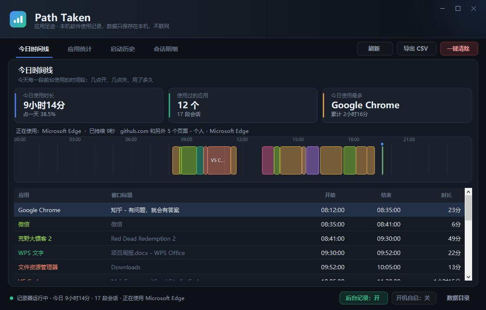
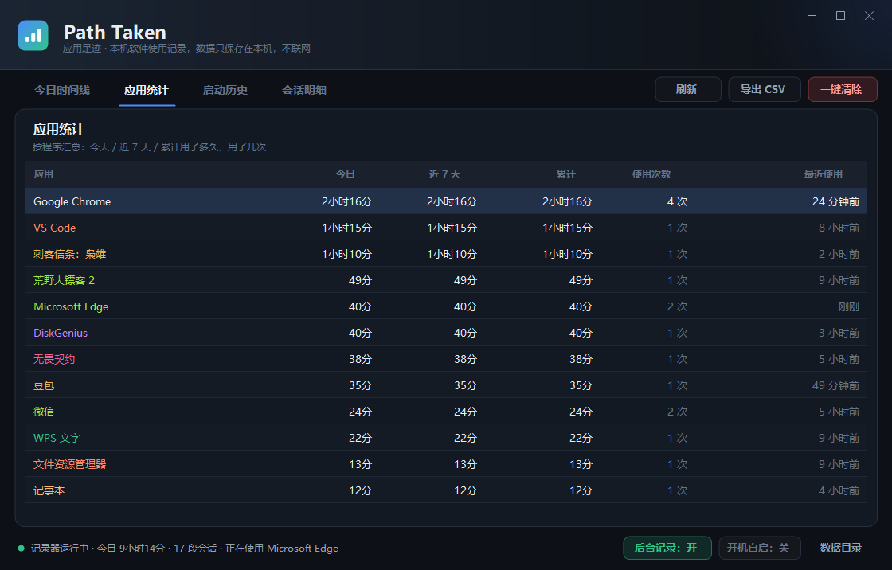
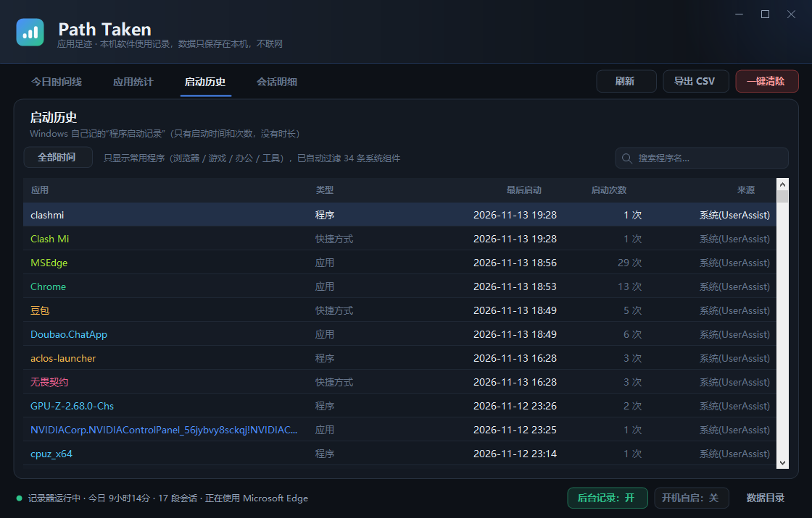
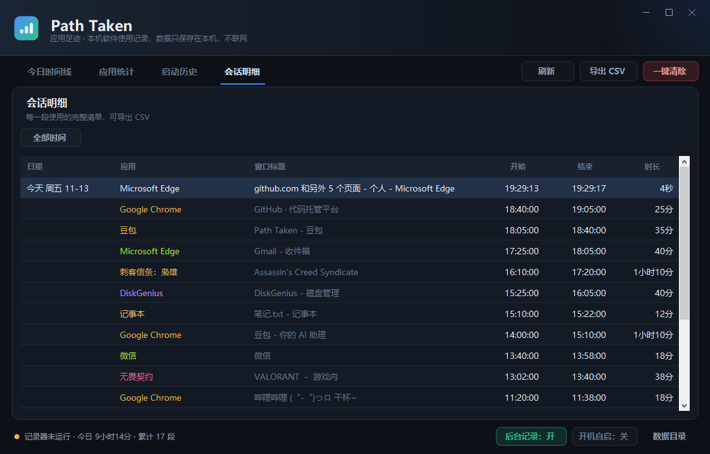
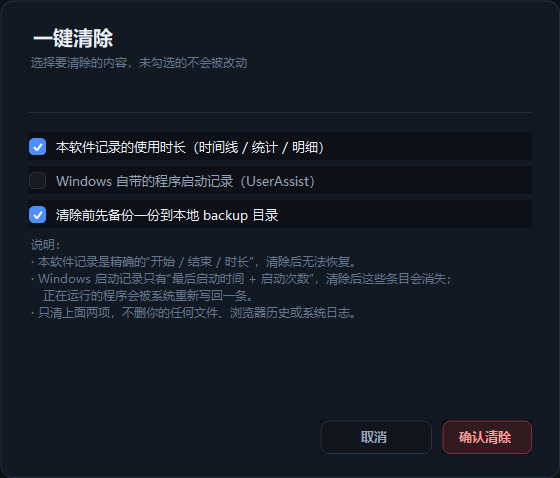

# Path Taken · 应用足迹

一个绿色单文件的 Windows 桌面小工具：**看清这台电脑上打开过什么程序、几点开、几点关、用了多久**，并且支持一键清除记录。

- 单文件 exe，约 433 KB，双击即用，**不需要安装、不落地一堆库**
- 纯 C# / WinForms 自绘界面，**不联网、不上传**，数据只存在本机
- 依赖系统自带的 .NET Framework 4.x（Win10 / Win11 已内置）



---

## 先说清楚：Windows 自己记了什么，没记什么

这一点决定了本工具的形态，值得花 30 秒看一眼：

| 你想要的信息 | Windows 自己有吗 | 本工具怎么给 |
| --- | --- | --- |
| 打开过什么程序 | 有（注册表 UserAssist 里存着程序路径和启动次数） | 「启动历史」页直接读系统已有记录，**装软件之前的历史也能看到** |
| 几点开的 | 只有"最后一次启动时间" | 同上 |
| 几点关的 | **没有**，系统只记最后一次启动时刻 | 「会话明细」页由本工具的后台记录器精确记录 |
| 用了多久 | **没有**，系统不统计时长 | 同上 |

结论：Windows 本身**不记录关闭时间和使用时长**（Prefetch 那类文件的时间戳在系统还原后会全部失真，所以本工具故意不采用，避免给出错误的"最后运行时间"）。

所以本工具分成两部分：

1. **启动历史**：读取系统已经存在的程序启动记录（UserAssist / BAM），装软件之前的历史也在里面。
2. **自带记录器**：一个 2 秒采样前台窗口的轻量后台进程，从它运行的那一刻起，精确记录「开始 / 结束 / 时长」，可以开机自启。

---

## 四个页签

| 页签 | 内容 |
| --- | --- |
| **今日时间线** | 24 小时横向时间轴，每段使用是一条彩色色块（几点到几点一目了然），配当日总时长、用过的应用数、用得最多的应用 |
| **应用统计** | 按程序汇总：今天 / 近 7 天 / 累计时长、使用次数、最近使用时间 |
| **启动历史** | Windows 记录的程序启动清单：最后启动时间 + 启动次数。**已自动过滤掉 30+ 条系统组件**，只留浏览器、游戏、办公、工具这类真实应用 |
| **会话明细** | 每一段使用的完整清单（日期 / 应用 / 窗口标题 / 开始 / 结束 / 时长），可导出 CSV |

界面底部常驻状态栏：记录器是否在跑、今日总时长、当前正在使用哪个程序。

## 一键清除

右上角「一键清除」，两个独立选项：

- **本软件记录的使用时长**（时间线 / 统计 / 明细）— 默认勾选，删掉本工具自己记的数据
- **Windows 自带的程序启动记录（UserAssist）**— 默认不勾选，清掉系统里那些"程序最后启动时间 + 启动次数"的条目

勾选「清除前先备份」会在 `%LOCALAPPDATA%\PathTaken\backup\<时间戳>\` 留一份备份，清完会在对话框里汇总清掉了多少条。执行前还有一次二次确认。

> 只清上面两项。不会动你的任何文件、文档、浏览器历史或系统日志。

## 后台记录器

- 同一个 exe，加 `--tracker` 参数就成了后台记录进程（无窗口，占内存极小）
- 每 2 秒采样一次前台窗口；**连续 2 分钟没有任何键鼠输入视为离开**，会话结束时间回退到那一刻，不会把挂机时间算成使用时间
- 崩溃后重启会自动收尾上一次残留在途会话
- 勾选「开机自启」会写一条 `HKCU\Software\Microsoft\Windows\CurrentVersion\Run\PathTaken`，登录后自动开始记录
- 少于 3 秒的切换不落盘；同一程序 60 秒内的连续片段会自动合并，列表不会碎成一片

## 数据存在哪

全部在 `%LOCALAPPDATA%\PathTaken\`：

| 文件 | 内容 |
| --- | --- |
| `sessions.log` | 已完成的会话，TSV：`开始 \t 结束 \t 应用 \t 窗口标题 \t 程序路径` |
| `current.log` | 正在进行中的那一段 |
| `heartbeat.log` | 心跳，20 秒没更新就认为记录器已退出 |
| `backup\` | 清除前的备份 |

纯文本，随时可以自己打开看、自己删，删掉不影响系统任何东西。

## 兼容性

- Windows 10 / Windows 11（64 位）实测可用
- 依赖 .NET Framework 4.x，Win10 1511 之后与 Win11 均自带
- Windows 7 需要自行安装 .NET Framework 4.8
- 无需管理员权限即可运行（个别系统的 BAM 记录读不到时静默跳过，不影响其他功能）

## 自己编译

不需要装 Visual Studio 或 .NET SDK，用系统自带的 .NET Framework 编译器就能编：

```bat
:: 双击 build.cmd 即可，产物在 dist\PathTaken.exe
```

等价的手工命令：

```bat
%WINDIR%\Microsoft.NET\Framework64\v4.0.30319\csc.exe /nologo /target:winexe /platform:anycpu /optimize+ ^
  /out:dist\PathTaken.exe /win32icon:app.ico ^
  /r:System.dll /r:System.Core.dll /r:System.Drawing.dll /r:System.Windows.Forms.dll src\*.cs
```

两个注意点：

1. `src\*.cs` 必须存成 **UTF-8 带 BOM**，否则老版 csc 会把中文字面量读成乱码。
2. 代码刻意只用 C# 5 语法（不用 `$"..."`、`?.`、属性初始化器、`out var`），因为 legacy csc 不认 C# 6+。

## 目录结构

```
PathTaken/
├─ src/
│  ├─ Program.cs      入口：界面 / --tracker 后台模式 / 单实例 / DPI
│  ├─ Theme.cs        深色主题、自绘控件（按钮、卡片、时间线、表格工厂）
│  ├─ Data.cs         数据模型、存储、前台追踪器、UserAssist/BAM 读取与清除
│  └─ MainForm.cs     主窗口、四个视图、一键清除对话框、开机自启
├─ app.ico           图标（16/32/48/64/128/256 多尺寸）
├─ make_icon.py      ico 生成脚本（纯标准库）
├─ dist/PathTaken.exe 编译产物（绿色单文件）
├─ build.cmd          一键编译
├─ LICENSE            MIT
└─ shot0~3.png        界面截图（演示数据）
```

## 已知限制

- **装软件之前的历史只有"启动时间 + 次数"，没有时长** —— 系统没存，任何工具都造不出来
- 商店应用（UWP）显示为包名，界面里能看到的是启动次数与最后启动时间
- 只记录**前台窗口**的程序，纯后台驻留（比如输入法、网盘同步）不会被统计
- 锁屏、睡眠期间不计入使用时长
- 记录器以当前用户身份运行，切换 Windows 用户后各自记录各自的

## 界面截图

| 应用统计 | 启动历史 |
| --- | --- |
|  |  |

| 会话明细 | 一键清除 |
| --- | --- |
|  |  |

> 截图里的记录是为了演示界面效果而生成的示例数据，不是真实使用记录。

## License

[MIT](LICENSE)
